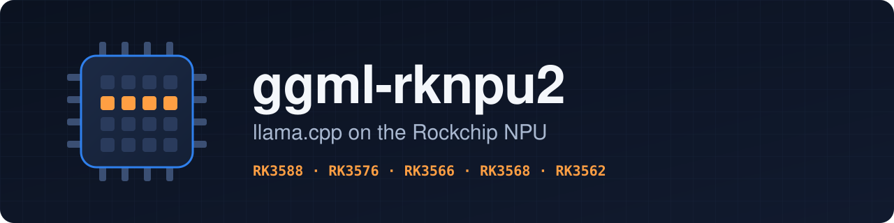

<p align="center"></p>

<p align="center">
  <b>Run llama.cpp on your Rockchip board and let the NPU do the heavy lifting.</b><br>
  One install command, models straight from Hugging Face, the same answers as the CPU.
</p>

<p align="center">
  <a href="https://github.com/anand34577/ggml-rknpu2/actions/workflows/ci.yml"></a>
  <a href="https://github.com/anand34577/ggml-rknpu2/releases/latest"></a>
  
  
</p>

---

## What it does

Rockchip chips like the RK3588 and RK3576 have an NPU, a small chip made for the large matrix
multiplications that language models spend most of their time on. llama.cpp normally ignores it
and does everything on the CPU.

ggml-rknpu2 is a llama.cpp backend that hands those multiplications to the NPU. In practice:

- **Reading your prompt** (the long text you paste in, a document, the chat history) is done in
  big batches, and those batches go to the NPU.
- **Writing the answer** happens one word at a time. That part stays on the CPU, which is better
  at it.
- **Answers do not change.** Anything the NPU cannot take, or fails at, quietly runs on the CPU
  instead. The tests check that the NPU path and the CPU give the same text.

It comes with `llama-npu`, a small command that sets llama.cpp up the right way for the NPU, so
you don't have to learn its flags first.

## Does my board work?

| Chip | NPU cores | Common boards |
|---|---|---|
| RK3588, RK3588S | 3 | Radxa ROCK 5, Orange Pi 5, Khadas Edge2, FriendlyElec NanoPC-T6 |
| RK3576 | 2 | Radxa ROCK 4D, Firefly ROC-RK3576-PC, Luckfox Omni3576 |
| RK3566, RK3568 | 1 | Radxa ROCK 3, Orange Pi 3B, Pine64 Quartz64 |
| RK3562 | 1 | Mostly industrial and tablet boards |

You also need:

- **64-bit Linux with Rockchip's vendor kernel.** That's the kernel most board makers ship
  (Radxa, Orange Pi, Armbian "vendor" images). It includes the `rknpu` driver. Mainline kernels
  don't work with Rockchip's runtime yet.
- **4 GB of RAM or more.** 8 GB is comfortable.

Not sure? Install it anyway and run `llama-npu check`. It tells you what's missing and how to
fix it. Without the NPU everything still works, just on the CPU.

## Install

On the board (over SSH is fine), run:

```sh
curl -fsSL https://raw.githubusercontent.com/anand34577/ggml-rknpu2/main/install.sh | bash
```

That's all. It takes a minute or two, needs no root, and puts everything in
`~/.local/share/ggml-rknpu2`. It downloads Rockchip's NPU runtime straight from Rockchip, and
on older systems (before Ubuntu 22.04 or Debian 12) it builds from source instead, which takes
10 to 40 minutes.

Open a new terminal afterwards so the `llama-npu` command is found.

## Use it

Chat in the terminal:

```sh
llama-npu chat Qwen/Qwen2.5-0.5B-Instruct-GGUF:Q8_0
```

The first time, this downloads the model from Hugging Face (675 MB) and keeps it in
`~/.cache/llama.cpp`. Type your message and press Enter. `Ctrl+C` quits.

Chat in your browser, from any computer on your network:

```sh
llama-npu serve Qwen/Qwen2.5-0.5B-Instruct-GGUF:Q8_0 --host 0.0.0.0
```

Then open `http://<board-ip>:8080`. The same address is an OpenAI-compatible API
(`/v1/chat/completions`), so tools like Open WebUI or Continue can use it.

Check that the NPU is really in use:

```sh
llama-npu devices     # should list: RKNPU2: Rockchip NPU (rk3588)
llama-npu check       # the full board check
```

All commands:

| Command | What it does |
|---|---|
| `llama-npu chat MODEL` | Chat in the terminal |
| `llama-npu serve MODEL` | Web chat and API on port 8080 |
| `llama-npu bench MODEL` | Speed test, with and without the NPU |
| `llama-npu check` | Check the board, driver and runtime |
| `llama-npu devices` | Show what llama.cpp can use |
| `llama-npu run PROGRAM` | Run any bundled llama.cpp program, like `llama-quantize` |
| `llama-npu update` | Install the latest release |
| `llama-npu uninstall` | Remove it |

`MODEL` is a `.gguf` file on the board or a Hugging Face name. Anything after the model goes
straight to llama.cpp, so every llama.cpp option still works.

## Which model?

Any GGUF model works. These are good first picks (all Apache 2.0):

| Model | Download | Board RAM |
|---|---|---|
| `Qwen/Qwen2.5-0.5B-Instruct-GGUF:Q8_0` | 675 MB | 4 GB and up |
| `Qwen/Qwen2.5-1.5B-Instruct-GGUF:Q4_K_M` | 1.1 GB | 8 GB and up |
| `Qwen/Qwen3-1.7B-GGUF:Q8_0` | 1.8 GB | 8 GB and up |
| `Qwen/Qwen3-4B-GGUF:Q4_K_M` | 2.5 GB | 8 GB and up |

Why the RAM matters: the NPU works in 16-bit numbers, so it keeps its own unpacked copy of the
model's weights. That copy is about 3.5 times the size of a 4-bit model file. It's capped at 3 GB
by default, and whatever doesn't fit stays on the CPU. See
[Models and memory](https://github.com/anand34577/ggml-rknpu2/wiki/Models-and-memory).

## How fast is it?

It depends on the chip, the model and the prompt length, so measure it on your board:

```sh
llama-npu bench Qwen/Qwen2.5-1.5B-Instruct-GGUF:Q4_K_M
```

Rows with `rpk 0` use the NPU, rows with `rpk 1` are the CPU alone. `pp512` (reading a 512-token
prompt) is the number the NPU changes. `tg64` (writing) runs on the CPU in both. Please share your
results in [Discussions](https://github.com/anand34577/ggml-rknpu2/discussions). Real numbers
from real boards help everyone.

## Settings

The defaults suit most people. These environment variables change them:

| Variable | Default | Meaning |
|---|---|---|
| `GGML_RKNPU2_MEM_MB` | `3072` | Most memory the NPU copy of the weights may use, in MB. The NPU can address 4 GB at most. |
| `GGML_RKNPU2_CORES` | all (3 on RK3588, 2 on RK3576) | NPU cores to use |
| `GGML_RKNPU2_MIN_M` | `128` | Smallest batch of tokens sent to the NPU |
| `GGML_RKNPU2_MAX_M` | `512` | Largest batch the NPU takes at once, bigger ones are split |
| `GGML_RKNPU2_SOC` | detected | Force the chip, e.g. `rk3576` |
| `GGML_RKNPU2_F32_WEIGHTS` | off | Also send 32-bit weights to the NPU (it computes them in 16-bit) |

Example: `GGML_RKNPU2_MEM_MB=3500 llama-npu chat model.gguf`.

## Documentation

The **[wiki](https://github.com/anand34577/ggml-rknpu2/wiki)** has step-by-step guides:
installing, your first chat, the browser chat and API, choosing a model, troubleshooting, and
building from source.

## Building from source

```sh
git clone https://github.com/anand34577/ggml-rknpu2.git
cd ggml-rknpu2
scripts/build.sh            # on the board, tuned for its CPU
dist/ggml-rknpu2/llama-npu check
```

`scripts/build.sh --help` lists the options. Tests run on any Linux PC, no board needed:
`tests/run.sh` checks the backend against a strict stand-in for the NPU on all five chips, and
`tests/e2e.sh` runs a small model through it and compares the answer with the CPU.

## How it works

The backend plugs into ggml, llama.cpp's compute library, like the CUDA or Vulkan backends do.
When llama.cpp plans a step, the backend accepts only the matrix multiplications the NPU handles
well: fixed model weights, batches of 128 tokens or more, and shapes the chip supports. On first
use it converts each weight to 16-bit in the NPU's own memory layout and keeps it there. The
output is split by columns across the NPU cores, which run at the same time. Everything else
goes to llama.cpp's normal CPU code.

The code is in [`backend/`](backend). [`patches/llama.cpp.patch`](patches/llama.cpp.patch) is
the 11-line change that registers it with llama.cpp, and [`versions.env`](versions.env) pins
the llama.cpp commit and Rockchip runtime it's tested with.

## Contributing

Bug reports, board test results and pull requests are welcome. See
[CONTRIBUTING.md](CONTRIBUTING.md). For security issues, see [SECURITY.md](SECURITY.md).

## License

MIT, see [LICENSE](LICENSE). ggml-rknpu2 builds on [llama.cpp](https://github.com/ggml-org/llama.cpp)
(MIT) and uses Rockchip's NPU runtime, which it downloads from Rockchip and does not
redistribute. Details in [THIRD_PARTY.md](THIRD_PARTY.md).

This is an independent project. It is not affiliated with or endorsed by Rockchip, Meta or the
llama.cpp maintainers.
